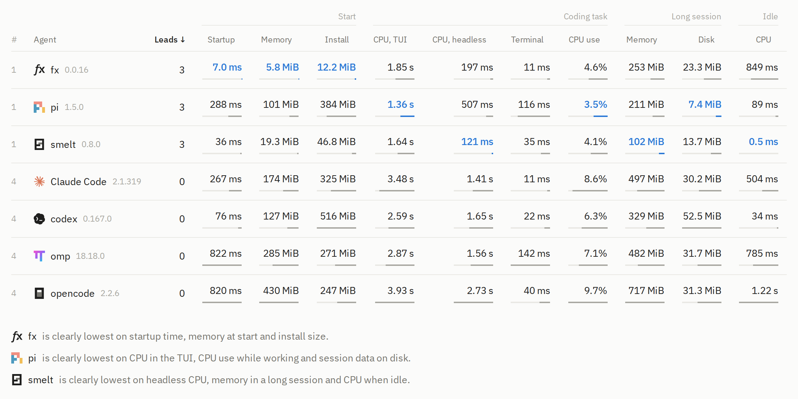

<p align="center">
  
</p>

<h1 align="center">Harness resource bench</h1>

<p align="center">
  Benchmarking CPU, memory and disk use of coding agents.
  <br />
  <a href="https://leonardcser.github.io/harness-lab/resources/"><strong>See the results</strong></a>
  ·
  <a href="bench/README.md">How it works</a>
</p>

<picture>
  <source media="(prefers-color-scheme: dark)" srcset=".github/readme/overview-dark.png" />
  
</picture>

How much does a coding agent cost your machine? This benchmark measures the
startup time, memory, CPU time, session data on disk and install size of Claude
Code, codex, fx, omp, opencode, pi and smelt.

A local mock model gives every agent the same scripted work: real tool calls
against real files, with the shape of real sessions. Each agent runs at a pinned
version in its own container, and the host measures the container from outside.

| Folder      | What it holds                                                                        |
| ----------- | ------------------------------------------------------------------------------------ |
| `bench/`    | The harness: agents, mock model, workload and measurement                            |
| `results/`  | One folder per run: manifest, summary and workload profile                           |
| `redirect/` | The old site's redirect to [harness lab](https://github.com/leonardcser/harness-lab) |

## Run the benchmark

On a fresh Ubuntu VM with 6 CPUs or more, to reproduce a released run:

```sh
git checkout COMMIT          # the commit on the Methodology page of the run
cd bench && ./setup.sh       # once; then log out and in again
uv run bench.py run          # all agents, about 8.5 hours
```

`run` checks the host, builds the images and measures, all in one session.
[`bench/README.md`](bench/README.md) explains how it works and what each case
measures.

To release a new run and share it, see [RELEASE.md](RELEASE.md).

## License

[MIT](LICENSE)
