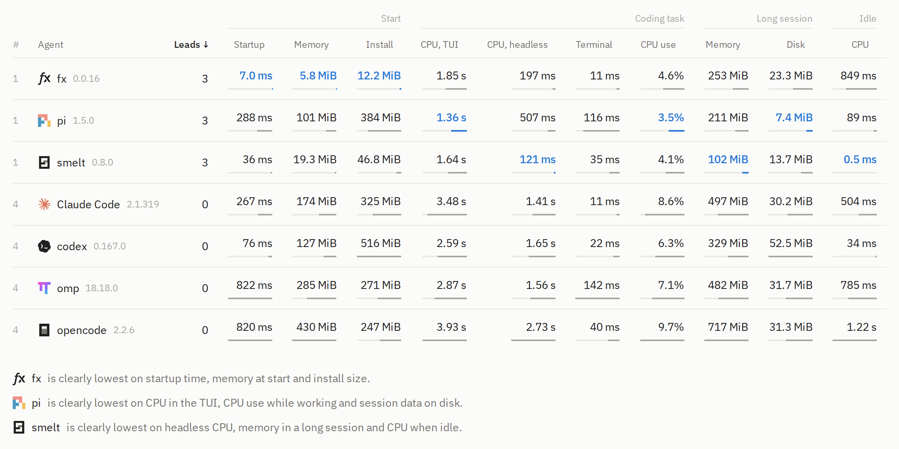

<p align="center">
  
</p>

<h1 align="center">Harness resource bench</h1>

<p align="center">
  Benchmarking CPU, memory and disk use of coding agents.
  <br />
  <a href="https://leonardcser.github.io/harness-resource-bench"><strong>See the results</strong></a>
  ·
  <a href="bench/README.md">How it works</a>
</p>

<picture>
  <source media="(prefers-color-scheme: dark)" srcset=".github/readme/overview-dark.png" />
  
</picture>

How much does a coding agent cost your machine? This benchmark measures the
startup time, memory, CPU time, session data on disk and install size of Claude
Code, codex, fx, omp, opencode, pi and smelt.

A local mock model gives every agent the same scripted work: real tool calls
against real files, with the shape of real sessions. Each agent runs at a pinned
version in its own container, and the host measures the container from outside.

| Folder     | What it holds                                                       |
| ---------- | ------------------------------------------------------------------- |
| `bench/`   | The harness: agents, mock model, workload and measurement           |
| `results/` | One folder per run, with its manifest, summary and workload profile |
| `web/`     | The site, which shows the run that `results/published.json` names   |

## Run the benchmark

On a Linux host with rootless podman, cgroup v2, tmux and
[uv](https://docs.astral.sh/uv/):

```sh
cd bench
uv run bench.py run        # all agents, about 8.5 hours
uv run bench.py check omp  # build and run the setup check only
```

`run` checks the host, builds the images, measures, and publishes the results
for the site. If it stops, run it again to continue.
[`bench/README.md`](bench/README.md) explains how it works, what each case
measures and how to update one agent.

## Build the site

With [bun](https://bun.sh):

```sh
cd web
bun install
bun run dev    # or: bun run build
```

`bun run lint` checks formatting and types.

## License

[MIT](LICENSE)
